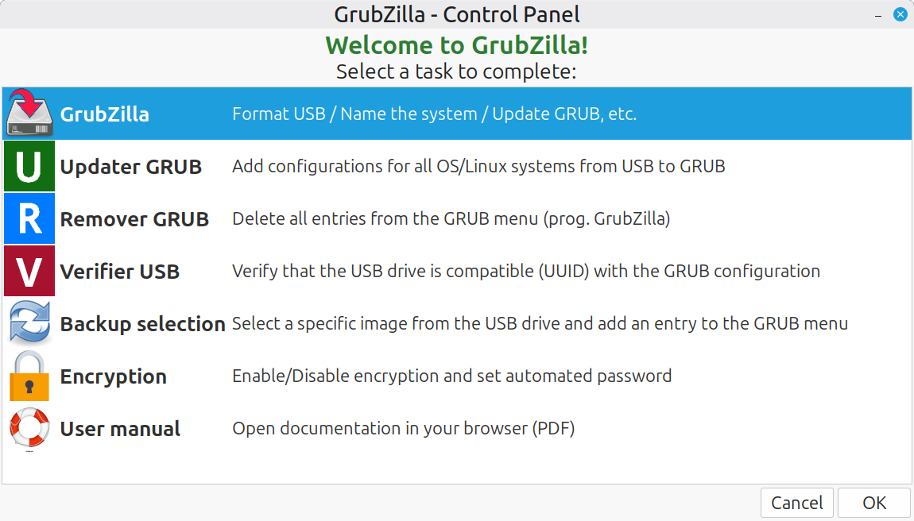
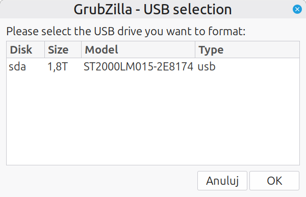
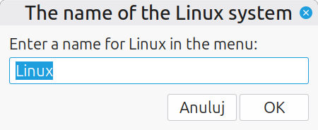
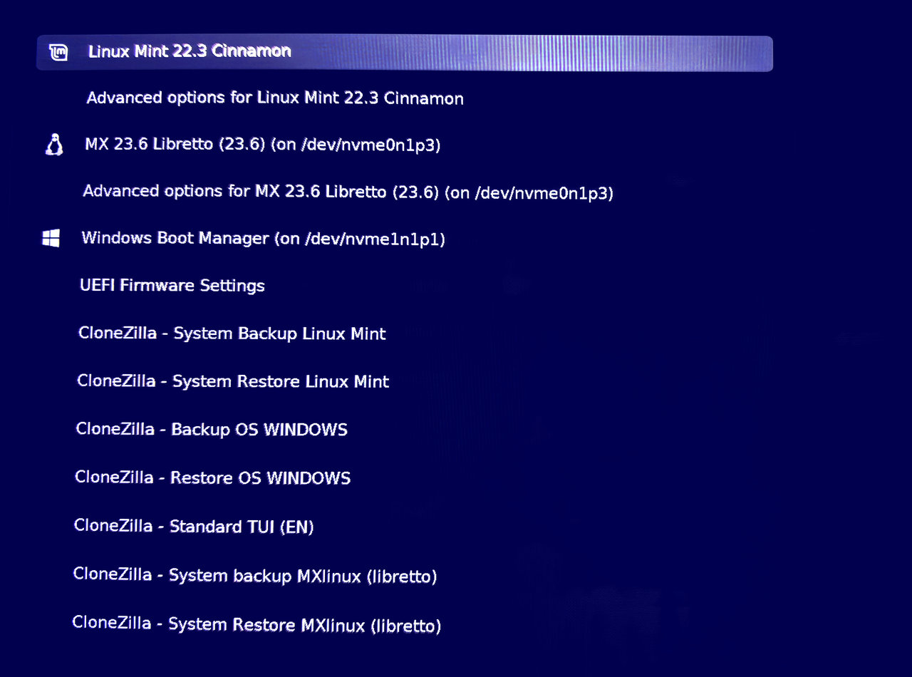
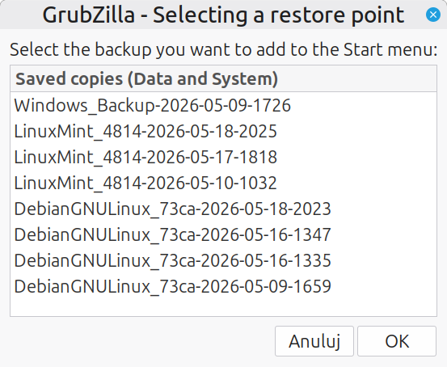
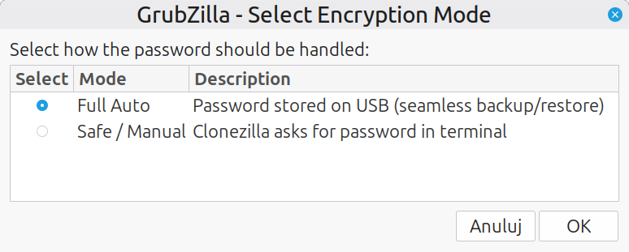
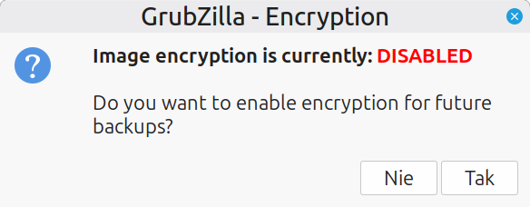
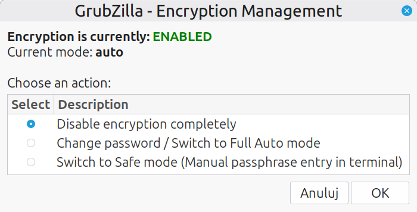

<h1 align="center">GrubZilla – User Guide & Documentation</h1>


**GrubZilla** integrates Clonezilla directly into your system's GRUB bootloader, enabling single-click system backup and bare-metal restore operations directly from the boot menu.

While Clonezilla is an exceptionally reliable and powerful utility for disk imaging, its classic Text User Interface (TUI) can be overwhelming for everyday desktop users. GrubZilla bridges this gap by fully automating partition detection, unattended execution, and encrypted storage handling for Debian- and Ubuntu-based Linux distributions (with experimental Windows NTFS support).

---

<mark>**CRITICAL WARNING – DATA LOSS HAZARD**</mark>

Initializing a drive with GrubZilla **completely formats the selected target device**, creating a dedicated two-partition layout:

1. **2 GB FAT32** partition (Label: `CLONEZILLA`)
2. **Ext4 storage partition** utilizing remaining disk space (Label: `CLONEZILLA_DATA`)

*<mark>System drives are safeguarded against accidental formatting, but selecting the wrong external USB drive will result in permanent data loss.</mark> Verify drive identifiers carefully before proceeding.*

---


## 1. Initial Setup: Preparing the USB Storage Drive

1. Connect your target external USB drive (HDD, SSD, or high-capacity flash drive).

2. Launch **GrubZilla** from your desktop environment (`Menu -> Administration` in Linux Mint, or `System` in other distributions).

   

   

   

3. Select the primary **GrubZilla** option from the control panel to initialize the USB drive:

   * Select your target drive from the list (e.g., `sdb`, `sdc`).
    
 <p align="center">
  
</p>
   
   * Enter a descriptive name for your Linux system to display in the GRUB boot menu.

     
<p align="center">
  
</p>

     

4. After formatting finishes, download the official **[Clonezilla Live ISO](https://clonezilla.org/downloads.php)**.

5. Copy the downloaded ISO file to the root of the **`CLONEZILLA`** (FAT32) partition and rename it strictly to:

   ```text
   /clonezilla.iso
   ```

> **Note:** If partitions fail to mount immediately after formatting, simply disconnect and reconnect the USB drive.

GrubZilla will automatically update your local GRUB configuration and store a backup copy of your original `/etc/grub.d/40_custom` in your home directory.

## 2. Multi-Boot Environments: Configuring Additional Systems

To add backup entries for secondary Linux installations residing on the same computer:

1. Boot into the secondary Linux distribution and connect the prepared GrubZilla USB drive.

2. Run the configuration tool:

   - **Via Terminal:**

     ```
     sudo bash /media/$USER/CLONEZILLA_DATA/grubzilla-scripts/configurator_OS.sh
     ```

   - **Via GUI Helper:** Launch the graphical helper script `configuratorOS-click-terminal`.

3. Specify a menu label for this OS. The script generates a configuration fragment on the FAT32 partition (`/system_name_id_grub_menu.txt`).

4. Repeat this procedure for each installed Linux system.

### Applying Menu Entries

> **IMPORTANT:** <mark>GRUB updates must be managed strictly from your **primary OS**</mark> (the system controlling the main MBR/EFI bootloader). Updating GRUB across multiple installations simultaneously will desynchronize boot configurations.

Return to your primary Linux OS, connect the USB drive, and trigger an update via:

- **GRUB Updater** from the GrubZilla control panel, or

- Running the updater directly in a terminal:

  ```
  sudo /usr/share/grubzilla/grubzilla-scripts/updater_GRUB.sh
  ```
  After updating GRUB and rebooting the system, additional entries should appear in
the GRUB menu. :

<p align="center">
  
</p>

## 3. Windows Support (Dual-Boot Environments)

GrubZilla automatically detects existing Windows NTFS installations (verifying partition structure and `System32` presence) and generates corresponding automated backup and restore menu entries.

- **Requirement:** The Windows system volume must **not** be encrypted with BitLocker or suspended in Windows Fast Startup / Hibernation mode.

## 4. Hardware Safety & Partition Boundaries

- **UUID Partition Binding:** Modern Linux kernels identify block devices non-deterministically during boot. To prevent destructive misalignments across varying drive layouts, GrubZilla binds partition operations strictly to unique **filesystem UUIDs** rather than static device identifiers like `/dev/sda` or `/dev/nvme0n1`.
- **System Scope:** GrubZilla images **only the system root partition (`/`)**. If your installation utilizes dedicated, isolated partitions or secondary drives for `/home` or personal data containers, they are **excluded** from the automated system image.

## 5. Restoration & Image Version Management

- **Default Restore Behavior:** Selecting a Restore entry from GRUB automatically rolls back your system using the **most recent** image archive located on the USB storage drive.
- **Selecting Specific Archives:** To restore an earlier point-in-time image, use the **Backup Selection** tool within the GrubZilla utility suite. This generates a dedicated GRUB entry for that specific archive.
<p align="center">
  
</p>
  
- **Manual Override:** Selecting `CloneZilla - Standard TUI (EN)` from the boot menu drops into Clonezilla's native interface for unrestricted manual operations.

## 6. Backup Encryption (gocryptfs)

GrubZilla integrates on-the-fly encryption utilizing modern `gocryptfs` containers within Clonezilla:

<p align="center">
  
</p>

- **Safe Mode (Manual):** Encrypts the backup while requiring manual password entry directly in the Clonezilla terminal during backup and restore phases. This setting **persists permanently** across reboots until manually disabled in GrubZilla settings.

- **Full Auto Mode (Unattended):** Configured by specifying an encryption password beforehand inside the GrubZilla interface. Enables completely silent, unattended execution without user intervention at boot.

  *Security Precaution:* The temporary configuration containing the active passphrase is **permanently destroyed via `shred`** immediately upon completion of the imaging run.
  
  

&emsp;&emsp;


## 7. Storage Maintenance & Multi-Drive Management

If one USB drive becomes full and you do not want to delete older backups:

- Run **Remover GRUB** to prune old entries from the local boot configuration without uninstalling core packages.
- Use another USB drive,
- Repeat all steps from this tutorial,
- Connect the USB drive with the new configuration,and 
- Run **Verifier USB** to detect device mismatches and sync UUID configurations automatically when alternating between multiple backup drives.

- If executing management scripts directly in a terminal, verify execution permissions:

  ```
  sudo chmod +x /usr/share/grubzilla/grubzilla-scripts/updater_GRUB.sh
  ```

> **FINAL BOOT REQUIREMENT**
>
> For Clonezilla images to execute unattended from the bootloader, your <mark>**GrubZilla USB storage drive MUST be connected before system power-on** (prior to the GRUB screen displaying).</mark>
